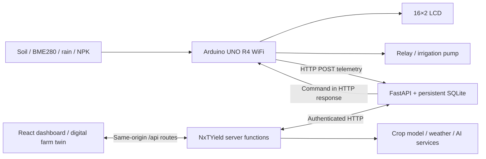

# NxTYield – FarmSense AI

An IoT-powered smart agriculture system combining soil and environmental monitoring, local and remote irrigation, ML-based crop recommendations, and a React dashboard with a digital farm twin.

## Achievement

🏆 **1st Runner-Up | Makers Conclave, Hyderabad | ₹1,00,000 Prize Winner**

Our team received **₹1,00,000 in prize money** for **NxTYield – FarmSense AI** at the **Makers Conclave, Hyderabad**.

## What it does

- **Monitor the field:** soil moisture, DS18B20 soil temperature, BME280 air temperature/humidity/pressure, rain detection, and RS485 NPK integration.
- **Control irrigation:** automatic moisture control, timed remote watering, Stop, rain priority, and a local LCD.
- **Connect hardware over HTTP:** the Arduino posts JSON to FastAPI and receives commands in the response. SQLite retains readings and commands across server restarts.
- **Show confirmed state:** the dashboard separates accepted commands from Arduino acknowledgments and reports offline/stale data.
- **Support decisions:** weather, crop recommendations, AI-assisted insights, and a visual farm twin through the existing web integrations.

**Prototype pH was simulated because the physical probe was not working. The hardware API leaves pH null. NPK values remain unavailable until the exact probe protocol and units are verified.**

## Architecture



The Arduino only makes outbound requests. The browser uses NxTYield's existing API routes; service credentials stay server-side. The Arduino reports its relay output, which is distinct from a measured water-flow reading.

## Get started

1. **Start FastAPI:** follow the [backend setup guide](backend/README.md) to create private keys and run the service on port 8000.
2. **Configure the dashboard:** copy [`.env.example`](.env.example) to `.env.local`, set its service URLs and keys, then run:

   ```bash
   npm install
   npm run dev
   ```

3. **Configure the board:** follow the [hardware guide](hardware/README.md), set WiFi/server details in a private `arduino_secrets.h`, then compile/upload [the sketch](hardware/FarmSenseAI/FarmSenseAI.ino).
4. Open `/dashboard`. Enter the operator key in **Remote Irrigation** to use Auto, Water now, and Stop. A command becomes confirmed after fresh Arduino telemetry acknowledges it.

The firmware starts with the relay off. Timed watering lasts 5–300 seconds; rain, sensor faults, command expiry and lost server contact can hold it off. See the [control rules](hardware/README.md#irrigation-control).

## Hardware

| Component | Role |
| --- | --- |
| **Arduino UNO R4 WiFi** | Sensor/controller board and HTTP client |
| **SEN0193** | Analog soil moisture, calibrated to a relative percentage |
| **DS18B20** | Soil temperature |
| **BME280** | Air temperature, relative humidity and pressure |
| **LM393 rain module** | Digital rain indication |
| **SN-3002-TR-N-N-NPK-N01 via MAX485** | RS485 nutrient probe; confirm register map and units |
| **16×2 I2C LCD** | Local moisture, temperature and relay status |
| **Relay and pump** | Irrigation output |

The controller is an extension of the maintainer-supplied reconstructed sketch. It is not the archived firmware from the event. Software checks and board compilation do not replace validation on the physical rig.

## Repository layout

```text
backend/                         FastAPI service, SQLite store, tests and hosting guide
hardware/FarmSenseAI/            BME280 WiFi firmware and private-configuration template
hardware/README.md               Pin map, libraries, calibration and control behavior
src/                            React dashboard and digital farm twin
api/                            Same-origin sensors, irrigation, weather and AI routes
server/                         Upstream adapters and their tests
tests/e2e/                      Browser test of the hardware/API/dashboard flow
.github/workflows/farmsense.yml  Backend, dashboard, browser and firmware checks
```

## Deployment and configuration

Host FastAPI with HTTPS and a **persistent disk**. The included Dockerfile supports a mounted SQLite volume. Keep NxTYield's frontend on Vercel or another compatible host; do not use an ephemeral function filesystem for the backend database.

For Vercel, use `npm run build` and output directory `dist`. Set these server-side variables and redeploy:

| Variable | Purpose |
| --- | --- |
| `SENSOR_API_URL` | FastAPI `/sensor-data` URL |
| `SENSOR_HISTORY_API_URL` | FastAPI `/sensor-history` URL |
| `IRRIGATION_API_URL` | FastAPI `/irrigation-active` URL |
| `FARMSENSE_API_KEY` | Matches the backend's dashboard service key |
| `IRRIGATION_CONTROL_KEY` | Separate key entered by an operator to authorize commands |
| `CROP_MODEL_API_URL` | Separate ML crop-prediction service |
| `OPENWEATHER_API_KEY`, `WEATHER_CITY` | Weather configuration |
| `GROQ_API_KEY`, `GROQ_MODEL` | Optional AI provider configuration |

The checked-in localhost URLs work when FastAPI runs on the same computer as the development server. A deployed app needs publicly reachable HTTPS service URLs. The board needs a LAN IP or real hostname, not `127.0.0.1`.

`npm run dev` serves the UI and local API handlers. `npm run preview` previews the frontend build only. Set `VITE_API_BASE_URL` only when intentionally changing the API origin; never put private keys in `VITE_*` variables.

## Data and verification

Hardware routes return unavailable/stale status when FastAPI or the controller cannot be reached. They do not silently substitute generated readings or successful pump commands. The frontend's explicit **Demo Mode** remains available, with physical irrigation controls disabled.

```bash
python -m pytest backend/tests -q
npm test
npm run lint
npm run build
npm run test:e2e
```

Browser-test prerequisites and Arduino compilation instructions are in the [backend guide](backend/README.md#verification) and [hardware guide](hardware/README.md).

## References

- [Arduino UNO R4 WiFi](https://docs.arduino.cc/hardware/uno-r4-wifi/)
- [Arduino WiFi and HTTPS examples](https://docs.arduino.cc/tutorials/uno-r4-wifi/wifi-examples)
- [Bosch BME280](https://www.bosch-sensortec.com/en/products/environmental-sensors/humidity-sensors-bme280)
- [FastAPI](https://fastapi.tiangolo.com/)
