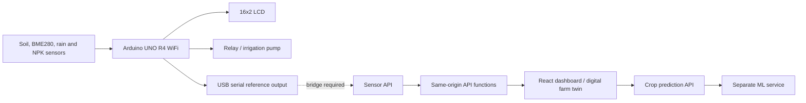

# NxTYield – FarmSense AI

An IoT-powered smart agriculture project combining soil and environmental monitoring, relay-controlled irrigation, and ML-based crop recommendations with an interactive web dashboard and digital farm twin.

## Achievement

🏆 **1st Runner-Up | Makers Conclave, Hyderabad | ₹1,00,000 Prize Winner**

Our team received **₹1,00,000 in prize money** for **NxTYield – FarmSense AI** at the **Makers Conclave, Hyderabad**.

## The system

NxTYield brings together a physical FarmSense controller, sensor/API services, and a React dashboard:

- **Soil monitoring:** relative soil moisture, soil temperature, and NPK readings.
- **Environmental monitoring:** air temperature, relative humidity, barometric pressure, and rain detection.
- **Irrigation:** a relay-controlled pump with rain-priority, moisture-threshold logic.
- **Local display:** a 16×2 I2C LCD for moisture, soil temperature, rain, and pump status.
- **Web experience:** sensor views, weather, crop recommendations, AI-assisted insights, and a visual digital farm twin.

**pH was simulated in the prototype because the physical pH sensor was not working. It must not be presented as a measured soil reading.**

## Hardware

| Component | Role |
| --- | --- |
| **Arduino UNO R4 WiFi** | Main FarmSense controller |
| **SEN0193 soil moisture sensor** | Analog moisture input, mapped to a calibrated relative percentage |
| **DS18B20** | Soil temperature |
| **BME280** | Air temperature, humidity, and barometric pressure |
| **LM393 rain detection module** | Digital rain indication |
| **SN-3002-TR-N-N-NPK-N01 NPK probe** | RS485 nutrient readings through a MAX485 interface |
| **16×2 I2C LCD, address 0x27** | Local status display |
| **Relay and irrigation pump** | Switched irrigation output |

The firmware and documentation use **BME280**, including humidity support.

See the [hardware guide](hardware/README.md) for wiring, libraries, calibration, data flow, and the [Arduino reference sketch](hardware/FarmSenseAI/FarmSenseAI.ino).

## Architecture



The added sketch is a **reconstructed hardware-side reference**, not the archived firmware used at the event. It outputs human-readable USB serial data. The serial-to-API bridge and direct Arduino WiFi publishing are not implemented in this reference sketch.

Crop prediction runs in a separate service configured by `CROP_MODEL_API_URL`; it does not run on the Arduino.

## Repository layout

```text
hardware/
  README.md                         Hardware, pin map and integration notes
  FarmSenseAI/FarmSenseAI.ino        Reconstructed BME280 controller sketch
src/                                React dashboard and digital farm twin
api/                                Same-origin sensor, weather, irrigation and AI routes
server/apiUtils.js                  Upstream integration and response normalization
.env.example                        Server-side configuration template
```

## Run the dashboard locally

```bash
npm install
npm run dev
```

The local Vite configuration serves the dashboard and the same `/api/*` handlers used by the deployment. Configure local services through a local `.env` based on [`.env.example`](.env.example).

```bash
npm run build
npm run preview
```

`npm run preview` previews the frontend build; the development API middleware is provided by `npm run dev`.

### Hardware reference

Open [`hardware/FarmSenseAI/FarmSenseAI.ino`](hardware/FarmSenseAI/FarmSenseAI.ino) in Arduino IDE, select **Arduino UNO R4 WiFi**, and install the libraries listed in the [hardware guide](hardware/README.md).

Before connecting the pump, verify the relay polarity and sensor wiring. Calibrate moisture values and confirm the NPK probe's protocol settings. The supplied register address and calibration values are reconstruction defaults.

## Deployment and configuration

For Vercel, import **SamsDevForge/NxTYield_Final**, keep the repository root, and use:

- **Build command:** `npm run build`
- **Output directory:** `dist`

| Variable | Purpose |
| --- | --- |
| `SENSOR_API_URL` | Upstream latest-sensor endpoint |
| `SENSOR_HISTORY_API_URL` | Optional sensor-history endpoint |
| `IRRIGATION_API_URL` | Reachable upstream irrigation service |
| `CROP_MODEL_API_URL` | External crop-prediction service |
| `OPENWEATHER_API_KEY` | Weather provider key |
| `WEATHER_CITY` | Weather location, for example `Pune,IN` |
| `GROQ_API_KEY` | Optional AI provider key |
| `GROQ_MODEL` | Model available to the configured provider account |
| `LOCAL_API_FALLBACKS` | Set `false` to disable generated local sensor/irrigation fallbacks |

The checked-in example uses `http://127.0.0.1:8000/irrigation-active` for local irrigation. A deployed function's loopback address is not your Arduino or computer; configure a reachable service URL for deployment.

The frontend uses same-origin `/api/*` routes by default. Set `VITE_API_BASE_URL` only when intentionally using a different API origin. Keep provider keys server-side.

## Hardware, demo, and unavailable data

- **Hardware data** requires a working controller-to-API integration.
- The frontend has an explicit **Demo Mode** with generated readings.
- Outside Vercel, server-side sensor and irrigation fallbacks can also generate local demonstration values when upstream calls fail. They are enabled unless `LOCAL_API_FALLBACKS=false`.
- With those fallbacks disabled, unavailable upstream services return `available: false` rather than a successful hardware result.
- **Prototype pH values are simulated**; a hardware packet should leave pH unavailable until a working physical sensor is integrated.

## References

- [Arduino UNO R4 WiFi documentation](https://docs.arduino.cc/hardware/uno-r4-wifi/)
- [Bosch BME280](https://www.bosch-sensortec.com/en/products/environmental-sensors/humidity-sensors-bme280)
- [Adafruit BME280 library](https://github.com/adafruit/Adafruit_BME280_Library)
- [ModbusMaster library](https://github.com/4-20ma/ModbusMaster)
