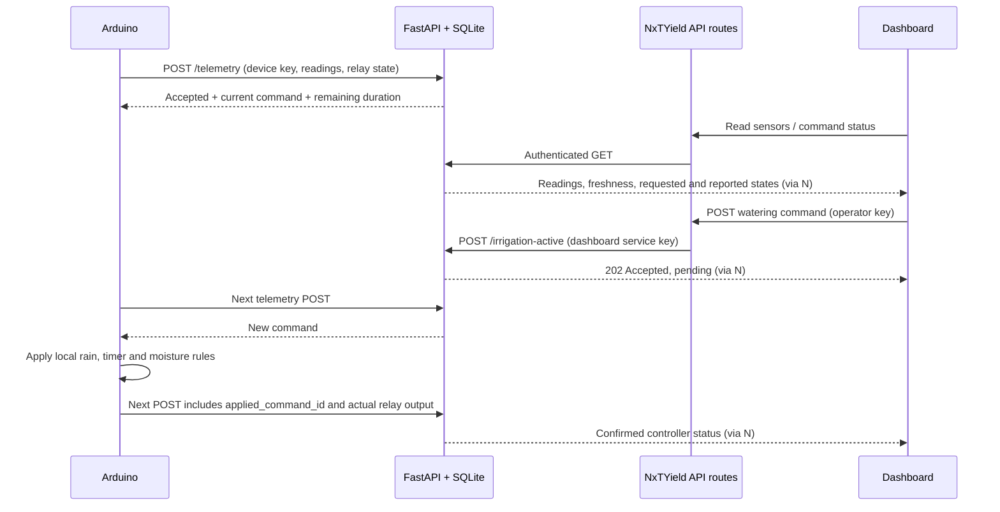

# FarmSense FastAPI service

This service connects an **Arduino UNO R4 WiFi / BME280 controller** to the NxTYield dashboard. It stores telemetry and irrigation commands in SQLite. It supports one configured controller per service/database.



The Arduino makes outbound requests. No port forwarding or HTTP server on the Arduino is required.

## Run locally

From the repository root, using Python 3.12+:

```bash
python -m venv .venv
# Windows PowerShell: .\.venv\Scripts\Activate.ps1
# macOS/Linux: source .venv/bin/activate
python -m pip install -r backend/requirements-dev.txt
```

Copy `backend/.env.example` to **`backend/.env.local`**. Generate two different keys, each at least 16 characters; 32 random bytes is recommended:

```bash
python -c "import secrets; print(secrets.token_urlsafe(32))"
```

Set `FARMSENSE_DEVICE_API_KEY` and `FARMSENSE_DASHBOARD_API_KEY` in that private file. Then run:

```bash
python -m uvicorn backend.app:app --host 0.0.0.0 --port 8000 --env-file backend/.env.local
```

- Health: `http://127.0.0.1:8000/health`
- Interactive API docs: `http://127.0.0.1:8000/docs`
- Database: `./data/farmsense.sqlite3` by default. Telemetry and commands survive restarts.
- A record becomes stale after **20 seconds** by default. The latest 10,000 samples are retained.

## Connect NxTYield

Copy the root `.env.example` to **`.env.local`** and configure:

```dotenv
SENSOR_API_URL=http://127.0.0.1:8000/sensor-data
SENSOR_HISTORY_API_URL=http://127.0.0.1:8000/sensor-history
IRRIGATION_API_URL=http://127.0.0.1:8000/irrigation-active
FARMSENSE_API_KEY=<same value as backend FARMSENSE_DASHBOARD_API_KEY>
IRRIGATION_CONTROL_KEY=<a third, different random operator key>
```

Run `npm install` and `npm run dev`, then open `/dashboard`. Enter the operator key in **Remote Irrigation** to unlock Auto, Water now and Stop. The page holds the key in memory; it is not saved to browser storage. Reading the public dashboard does not authorize watering.

The server-side NxTYield routes attach the dashboard service key to FastAPI requests. **Never put these keys in `VITE_*` variables**, source files, repository secrets examples, or URLs. Normal browser access uses the same-origin `/api/*` routes, so no permissive CORS configuration is needed on FastAPI.

## Connect the Arduino

1. Follow the [hardware guide](../hardware/README.md) and install its libraries.
2. Copy `hardware/FarmSenseAI/arduino_secrets.example.h` to `arduino_secrets.h` beside the sketch.
3. Set WiFi credentials, `FARMSENSE_DEVICE_ID` (default `farmsense-01`) and the backend's **device** API key.
4. Set `FARMSENSE_HOST` to the server hostname **without** `http://`, `https://` or a path.
5. For LAN development, use your computer's LAN IP, port **8000**, and `FARMSENSE_USE_TLS 0`. The Arduino cannot reach the computer through `127.0.0.1`. Allow the service through the local firewall as appropriate.
6. For an internet-facing deployment, use the HTTPS hostname, port **443**, and `FARMSENSE_USE_TLS 1`. Keep the board's WiFi firmware/certificate bundle current.

The controller sends a sample about every two seconds, plus sensor/network processing time. Each successful telemetry response carries the current command. The following sample acknowledges it and reports the relay output. A relay output is not proof of water flow; this hardware list has no flow sensor.

## HTTP contract

All authenticated requests use `Authorization: Bearer <key>`.

| Method / route | Key | Purpose |
| --- | --- | --- |
| `GET /health` | None | Service/database health and controller online flag |
| `POST /telemetry` | Device | Validate/store readings; return current command |
| `GET /device/command` | Device | Read the current command without sending telemetry |
| `GET /sensor-data` | Dashboard service | Latest sample and freshness |
| `GET /sensor-history?limit=60` | Dashboard service | Oldest-to-newest history, maximum 1,000 per request |
| `GET /irrigation-active` | Dashboard service | Requested mode, acknowledgment and reported relay state |
| `POST /irrigation-active` | Dashboard service | Queue Auto, timed Water now or Stop |

Example Arduino telemetry body:

```json
{
  "device_id": "farmsense-01",
  "boot_id": "controller-session-1",
  "sequence": 1,
  "uptime_ms": 2000,
  "moisture": 31,
  "soil_temperature": 23.5,
  "air_temperature": 27.1,
  "humidity": 61.4,
  "pressure": 1008.2,
  "nitrogen": null,
  "phosphorus": null,
  "potassium": null,
  "ph": null,
  "rain_detected": false,
  "irrigation_active": false,
  "control_mode": "off",
  "control_reason": "startup",
  "applied_command_id": null,
  "sensor_errors": ["npk_protocol_unverified"]
}
```

`boot_id` changes on controller restart and `sequence` increases within that boot. Retrying a retained `(boot_id, sequence)` does not duplicate history or refresh last-seen time. Lower out-of-order sequences are rejected. Server receipt time is authoritative; the Arduino does not need a wall clock.

Missing/failed readings are `null`. Zero is a valid reading. This hardware has no working pH probe, so non-null pH is rejected. NPK is disabled in firmware until the actual register map and units are confirmed; it is never filled with invented values.

Watering commands:

```json
{"mode": "remote_on", "duration_seconds": 60}
```

```json
{"mode": "off"}
```

```json
{"mode": "auto"}
```

- **Auto:** start below 35% relative moisture; stop at 45%. The hysteresis band reduces relay switching.
- **Water now:** a 5–300 second lease, beginning when the server accepts the command. Polling does not renew it. Starts are rejected when telemetry is stale, rain is detected, or moisture is unavailable.
- **Stop:** hold the relay off. If the device is offline the command remains pending until reconnection; the UI does not claim an immediate physical stop.
- **Priority:** rain and invalid moisture hold watering off. Firmware also limits continuous pump operation to five minutes.
- **Expiry or lost server contact:** remote watering stops locally and stays off until a new command. The link timeout is 15 seconds. Timed commands are bound to a boot ID, so rebooting cannot resume an old watering session.
- **Auto while offline:** once Auto is selected, local moisture/rain control can continue without the server. Startup begins off until a server command is received.

`202 Accepted` means the server stored a command. `pending` stays true until fresh telemetry reports the matching `applied_command_id` and mode. `actual_irrigation_active` is `null` when the controller is offline. The UI shows rain/timeout/runtime interlocks even when a remote command has been delivered.

The controller uses synchronous sensor and network libraries; an interlock is evaluated between those operations. HTTP connection/response timeouts are configured to 2.5 seconds, but this is not a hard real-time cutoff. Validate timing and relay behavior on the actual rig before connecting a pump.

## Hosting

Run FastAPI on a server/container with a **persistent writable disk** and HTTPS. Keep the React/Vercel app's API URLs pointed at that service. This SQLite version is designed for a single service and controller, not an ephemeral filesystem or horizontally replicated functions. Do not place its database in a Vercel function's local filesystem.

An included Dockerfile can be built from the repository root:

```bash
docker build -f backend/Dockerfile -t farmsense-api .
docker run --env-file backend/.env.local -p 8000:8000 -v farmsense-data:/data farmsense-api
```

For Docker, remove `FARMSENSE_DATABASE_PATH` from the env file or set it to `/data/farmsense.sqlite3` so it uses the mounted volume. Put an HTTPS reverse proxy or the host's managed TLS endpoint in front of the container. Back up the SQLite database using a consistent SQLite backup method.

On Vercel set `SENSOR_API_URL`, `SENSOR_HISTORY_API_URL`, `IRRIGATION_API_URL`, `FARMSENSE_API_KEY` and `IRRIGATION_CONTROL_KEY` as server-side environment variables, then redeploy. Existing crop model, weather and AI routes remain separate.

## Verification

```bash
python -m pytest backend/tests -q
npm test
npm run lint
npm run build
npx playwright install chromium
npm run test:e2e
arduino-cli compile --fqbn arduino:renesas_uno:unor4wifi hardware/FarmSenseAI
```

The browser test runs an isolated FastAPI database and Vite server on ports 8001/5174, publishes test controller packets, requests watering through the UI, acknowledges it, checks rain/stop behavior, and waits for offline state. It does not contact a physical Arduino. Python and the backend test dependencies must be available to `npm run test:e2e`.

Sources: [FastAPI request bodies](https://fastapi.tiangolo.com/tutorial/body/), [lifespan](https://fastapi.tiangolo.com/advanced/events/), [testing](https://fastapi.tiangolo.com/tutorial/testing/), [Arduino WiFi examples](https://docs.arduino.cc/tutorials/uno-r4-wifi/wifi-examples).
